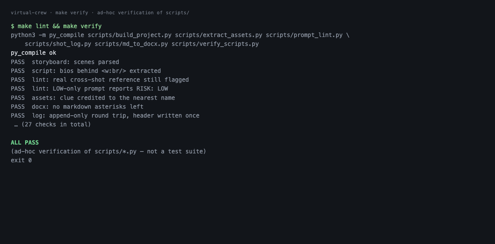

# Virtual Crew

**An agent crew for AI film production — the director keeps judgement, the agents keep the paper-trail.**
把 AIGC 短片的工作流拆成剧组岗位，每个岗位做成一个可安装的 agent skill。


Most AI-film projects demo a model. This one documents the **method**: how a shot gets specified,
checked, generated, inspected against a written contract, reworked, and archived — with the human
decision points named explicitly.

## Quick start

After installing (below), you talk to the crew the way you would to a person. The examples below use
the fictional project in `examples/the-visitor/` — the repository never ships a real production:

> **shot sc1-shot2 — write the prompt**

and you get back four things: the continuity list for that shot (every fact that must be re-described
in full, because the generator has no memory), the reference plates to attach, a copyable prompt with
reverse locks, a QC risk report — and the filename to save the take under. **You** generate the clip
in your own tool. Then you report what is wrong in plain speech:

> **the door is white and double, and the bag is missing**

and the crew returns a comparison report (expected / observed / severity / attribution), prompt v2
with the change list, and one row in the take log.

## Demo

Same two commands the crew runs on every shot — a prompt as first written, the same prompt after the
fix, the rework accounting, and the verification harness:




## The crew — seven skills

| Skill | Role | What it owns |
|---|---|---|
| `virtual-crew` | 总调度 | The loop itself: stage A (assets) → stage B (per shot), the two human gates, the triage of every reported problem into the skill that owns it. |
| `asset-forge` | 造型/置景 | Stage A: from script + storyboard, extracts character identities and their variants, **four directional views per location**, and props — into one asset document (markdown + Word) in the project. |
| `continuity-supervisor` | 场记 | The world-state: who is where, in what wardrobe, holding what, under which light, and which set facts may not drift. Expands continuity into fully re-described prompt sections. Flags drift after a take. |
| `art-department` | 美术指导 | Style DNA (palette / era / single-light rule), the plates a shot needs, which are missing, and style drift or anachronism. |
| `qc-reviewer` | 审片 | Pre-flight check of a prompt against a catalogue of observed model failure modes, with rewritten lines. |
| `line-producer` | 制片 | Rework rounds per shot, failure-type ranking, high-risk forecast for upcoming shots. |
| `ethics-gate` | 伦理闸门 | Content-boundary check before generation: pass / revise / refuse, plus non-depicting alternatives. |

## The example project (what the data layer looks like)

`examples/the-visitor/` is a complete, fictional, sanitised run of the pipeline — two characters, one
location, six shots. It is the file set the crew produces, so you can see the shape of the work without
reading anybody's real film. From `examples/the-visitor/assets_prompts.md`:

```
### A3 The Son · soaked (V01)
【不变的部分】face, bone structure, hair and build strictly copy the uploaded identity plate —
the same person, unchanged.
【变化的部分】a dark T-shirt and dark trousers, soaked through: the fabric clings, its colour
darkened by water; hair wet and dripping onto his face; a worn canvas bag on one shoulder.
【禁止出现】the water must be clear — not blood, not red; no wounds; don't change the face.
```

```
### B3 The flat · south view (camera at the kitchen passage, looking north)
【画面范围】square on the north wall: the entry door inside, its handle on the right, the mat on
the floor, the water trail leading in from the threshold.
【固定事实】the door is single-panelled, dark wood, and closed; the mat sits inside it.
【禁止出现】the door must not be a double door, must not be white, nothing visible outside it.
```

The full document (identities written out to the face, variants carrying only the change, four
directional views per location, props with standing rules) is at
`examples/the-visitor/assets_prompts.md` — and it is the same format used in production.

## The loop

The crew writes and checks prompts; the director generates and judges. Generation is deliberately
**not** automated: driving a render queue from an agent only puts latency between the director's eyes
and the next prompt.

```
shot id ──▶ look up (shotlist + world-state)
        ──▶ draft prompt (continuity + art + ethics + QC checks)
        ──▶ GATE 1: director approves or edits                      ◀── human
        ──▶ director generates the clip (their tool, their quota)
        ──▶ GATE 2: director reports, in plain speech, what is wrong ◀── human
        ──▶ structured comparison report ──▶ prompt v(n+1) ──▶ back to GATE 1
        ──▶ director says usable ──▶ ending state written back to the world-state
        ──▶ every take logged: rework rounds, failure types, attribution
```

Per shot the crew delivers **a prompt, a comparison report, and a number**. The generation itself
never leaves the director's hands.

## Install

```
git clone <this-repo> virtual-crew
cp -r virtual-crew/skills/*  ~/.hermes/skills/        # or your agent's skill directory
cp virtual-crew/project-profile.example.yaml  <your-project>/project-profile.yaml
```

Then edit `project-profile.yaml` (project paths, look, generation driver, folders, naming) and start
a session — see Quick start above.

## Repo layout

```
skills/           seven skills: virtual-crew (orchestrator) + asset-forge, continuity-supervisor,
                  art-department, qc-reviewer, line-producer, ethics-gate
templates/        asset-prompt-document · prompt-skeleton · watch-list · comparison-report · world-state
scripts/          build_project.py    parse script + storyboard → shotlist + world-state skeleton
                  extract_assets.py   → asset inventory (characters, variant clues, scenes, props)
                  md_to_docx.py       markdown → Word, for prompts the director copies out
                  prompt_lint.py      static pre-flight check of a prompt
                  shot_log.py         take log + rework / failure-type statistics
                  verify_scripts.py   the checks behind `make verify`
examples/         the-visitor/ — a small fictional project showing the data layer end to end:
                  script → shotlist → world_state → assets_prompts (11 prompts: identities, variants,
                  four location views, props) → a shot prompt → a comparison report → the take log
docs/             one-pager.md (work statement) · demo-script.md · figures/ · github-metadata.md
assets/           demo/ (screen recording — pending) · before-after/ (frame evidence — pending)
Makefile          make verify · make lint
```

## Requirements and compatibility

- **Runtime:** any agent that loads `SKILL.md`-style skills — Hermes Agent (copy into
  `~/.hermes/skills/`), Claude Code skills, or a plain system prompt (the `SKILL.md` files are
  ordinary markdown).
- **Python:** 3.8+, standard library only. No `pip install`.
- **Keys:** none. No API key lives in this repo and none is required — generation is external.
- **OS:** macOS, Linux, Windows (the scripts are pure Python; `md_to_docx.py` writes the .docx itself,
  so no Word needed).

## Verification

```
make lint      # py_compile every script
make verify    # 27 checks: parsers, prompt linter severity, inventory attribution,
               # .docx package validity, take-log round-trip — exit 0 = pass
```

`make verify` is ad-hoc verification of the scripts, not a full test suite: it builds a synthetic
`.docx` in a temp directory, exercises the parsers and writers, checks that the linter flags what it
should (and stays quiet on legitimate phrasing), validates the .docx package, and round-trips the
take log. Everything it creates is deleted at the end.

## Design notes

- **Two human gates, and only two.** Approve the prompt; judge the clip. Everything else is
  bookkeeping — which is exactly what should be automated.
- **No cross-shot references, ever.** "Same as the previous shot" is a wasted instruction; every fact
  is written out again in every prompt.
- **Reverse locks.** Each prompt names what must *not* happen. Roughly half of the rework traced back
  to a missing lock, which is why the failure catalogue is a first-class artefact.
- **Assets before shots.** Character identities pin the face in detail; variants describe only the
  delta and copy the uploaded identity plate. Locations get four directional views so a room cannot
  change shape when the camera turns around.
- **The catalogue is empirical.** Entries are written only after a take actually failed that way, and
  each carries the countermeasure wording that fixed it.

## Scope and honest limits

- The **method and tooling** are project-agnostic; the **project layer** (script, storyboard,
  world-state, assets, style DNA) is data you re-supply per film.
- The failure catalogue is model-specific. Entries here were collected against one text-to-video
  model; the structure transfers, the entries must be re-earned when you change models.
- QC is done by a human on purpose: the director watches and reports, the crew structures the report.
  No vision model is called, so no frame of an unreleased film leaves the machine.
- Generation is out of scope by design. No render queue for an agent to babysit.

## Roadmap

- [ ] `scripts/continuity_diff.py` — the drift check is currently done by hand
- [ ] 30-second demo recording (`assets/demo/`) + its shot-by-shot script
- [ ] sanitised before/after frame pairs (`assets/before-after/`)
- [ ] a second section in the failure catalogue for a different model

## License and author

Code (`scripts/`) MIT. Documentation and skill text (`skills/`, `templates/`, `README.md`)
CC BY-NC 4.0 — no commercial use. See `LICENSE`.

Author: Xinrui Shao · the portfolio case study is submitted separately (it is not part of this repo).
If you cite this: “Virtual Crew — an agent crew for AI film production (2026)”.
